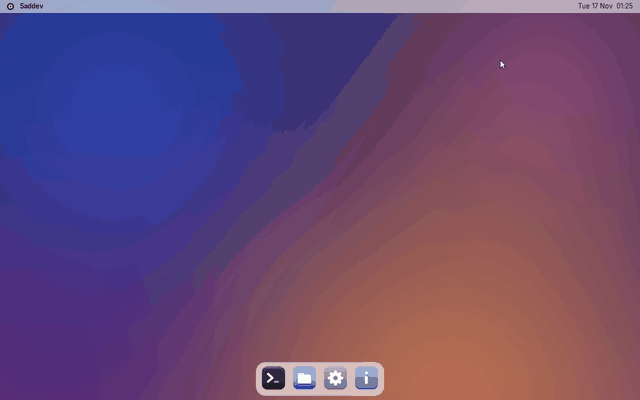

# Saddev

A small operating system for x86_64, written from scratch in C: its own
kernel, C library, window server, desktop and applications. No code from
other kernels, no third-party libraries.



## Run it

```bash
tools/setup.sh
```

```bash
make run
```

`tools/setup.sh` installs the tools the build needs on Debian or Ubuntu
(clang, lld, nasm, xorriso, qemu, python3 with Pillow); on another system
install the same packages by hand. `make run` builds everything and opens
the desktop in QEMU. The first build downloads the boot loader once.

| command | what it does |
|---|---|
| `make run` | build and start the desktop in QEMU |
| `make check` | run all automated checks (boots the system once per check) |
| `make demo` | record a tour of the desktop into `build/demo/` (needs no display) |
| `make bench` | time the drawing operations |
| `make debug` / `make gdb` | start under a debugger |

## What is inside

```
boot/            boot loader configuration (Limine)
arch/x86_64/     everything specific to the CPU: entry, tables, traps, paging, timers
kernel/          core, memory, scheduler, IPC, system calls, file systems, drivers
abi/             definitions shared by kernel and programs
libc/            the C library programs are linked with
user/libgui/     drawing, text, animation, window client library
user/compositor/ the window server
user/desktop/    wallpaper, menu bar, dock
user/apps/       terminal, shell, files, settings, about
tools/           build helpers and the scripts that drive the checks
docs/            how each part works and why
```

The kernel knows nothing about windows: it offers processes, memory,
channels, shared memory and a frame buffer. The window server is an
ordinary program.

Start reading at [docs/ARCHITECTURE.md](docs/ARCHITECTURE.md); there is one
note per subsystem, in the order they were built.

## Status

Version 1.0. Runs in QEMU. What it cannot do is listed under "Known limits"
in [docs/12-polish.md](docs/12-polish.md).

## Licences

The typefaces Inter and JetBrains Mono are under the SIL Open Font License
(`third_party/fonts/`). The boot loader Limine is downloaded at build time
and is under the BSD 2-Clause licence. Icons and wallpapers are drawn by the
system's own code.
