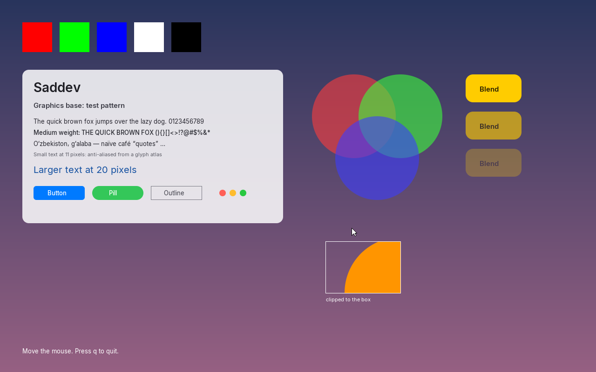

# 07 - Graphics base: display, mouse, drawing, text

The first pixels. The kernel's part is small on purpose: it describes the
display, lets one process map it, and delivers input events. Everything that
decides what a pixel looks like is in user space.

## Kernel side

### Display

The bootloader sets the video mode (`resolution: 1280x800x32` in
`boot/limine.conf.in`) and reports a linear framebuffer through a Limine
request. `kernel/drivers/framebuffer` accepts only 32-bit `0x00RRGGBB`
pixels and offers two operations, exposed as system calls:

- `fb_info`: width, height, bytes per row;
- `fb_map`: map the display memory into the calling process.

Only one address space may hold the mapping at a time (`EBUSY` otherwise):
two programs drawing behind each other's back would only produce garbage.
The claim is released automatically when the mapping goes away, including
when its process dies. This reuses the *borrowed frames* regions added for
shared memory.

### Mouse

A PS/2 mouse on the second port of the 8042 controller.

- **Controller** (`i8042.c`): the keyboard and mouse share one output
  buffer; a status bit says which device a byte came from. One interrupt
  routine, registered on both IRQ 1 and IRQ 12, drains the buffer and
  dispatches.
- **Protocol** (`ps2_mouse.c`): three-byte packets (buttons and sign bits,
  x, y). Bit 3 of the first byte is always set, which lets the decoder
  resynchronise after a lost byte. The scroll wheel is an extension that is
  switched on with a "knock" (sample rates 200, 100, 80); the mouse then
  identifies as type 3 and sends a fourth byte.
- **Queue** (`mouse.c`): when full, new motion is folded into the newest
  event, so the pointer never falls behind the hand; only intermediate
  points are lost.

### Input devices

`/dev/keyboard` and `/dev/mouse` deliver fixed-size event records
(`abi/saddev/input.h`). A read returns as many whole events as fit and
blocks while there are none; both can be polled. Key codes moved into the
ABI header, since user space now needs them.

## libgui: drawing (`user/libgui`)

### Surfaces and premultiplied alpha

A `gfx_surface` is a rectangle of 32-bit pixels with a clip rectangle.
Colours passed to drawing functions use ordinary alpha; pixels **stored** in
a surface are *premultiplied*: half-transparent red is `(128, 0, 0, 128)`.

Blending then becomes `result = source + destination * (1 - source alpha)`:
one multiplication per channel, and transparent edges do not pick up colour
fringes when surfaces are composited over each other.

Division by 255 is done exactly with `((x + 128) * 257) >> 16`, and two
channels are scaled per multiplication by spreading them across one 32-bit
word.

### Shapes

`gfx_clear` (replace), `gfx_fill_rect`, `gfx_stroke_rect`,
`gfx_fill_rounded_rect`, `gfx_fill_circle`, `gfx_fill_gradient`, `gfx_blit`
(copy) and `gfx_blend` (composite with an overall opacity).

**Anti-aliasing.** A pixel on a curved edge is given a *coverage* between 0
and 1: the edge is treated as a one-pixel ramp around the circle's radius,
using the distance from the pixel centre to the circle centre. One corner is
computed and mirrored to the other three.

### Text

The OS has no font rasterizer. `tools/mkfont.py` draws every glyph of a
TrueType font at one pixel size, at build time, into an **atlas**: one 8-bit
image where each byte is the coverage of that pixel, plus a table of glyph
metrics. Text is drawn by blending those bitmaps in the text colour.

- Fonts are Inter (SIL Open Font License) in three weights and five sizes,
  shipped as `/fonts/Inter-<Weight>-<size>.sdf` (about 30 KiB each).
- Text is UTF-8. The atlas holds ASCII, Latin-1 and a few typographic
  characters, including U+02BB used in Uzbek (oʻ, gʻ).
- Pen positions are tracked in 1/64 pixel so rounding does not accumulate.
- There is no kerning; glyphs are placed on whole pixels.

## Check

`user-gfx` runs `user/tests/gfx.c`, which draws the pattern above and a
cursor that follows `/dev/mouse`. Composition happens in an off-screen
frame; only the rectangle around the old and new cursor positions is redrawn
and copied to the display.

`tools/qemu-gfx-check.py` verifies the result from outside, through QEMU's
machine protocol:

1. waits for the program's "ready" line;
2. takes a screenshot and compares the five colour patches (red, green,
   blue, white, black) exactly, and finds the cursor where the program says
   it is;
3. injects four mouse movements;
4. takes a second screenshot: the cursor must be at the new position, must
   have left no copy behind, and **no pixel outside the two cursor
   rectangles may have changed**;
5. presses `q`, which makes the program exit successfully. If any check
   failed the key is never sent and the test times out.

Measured under emulation without KVM: drawing the whole pattern takes about
15 ms, presenting a full 1280x800 frame about 5 ms.

## Known limits

- The display memory is mapped with default caching. On real hardware it
  should be write-combining; under QEMU it makes no difference.
- No SSE-specific code yet; that is planned after dirty rectangles.
- Gradients are not dithered, so wide ones show faint bands.
- The keyboard has one event queue: `/dev/console` and `/dev/keyboard`
  compete for it.
