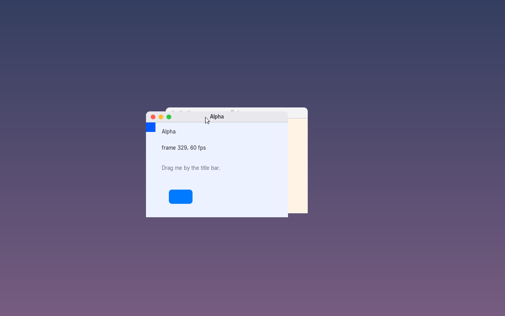

# 08 - The window server

`/bin/compositor` is an ordinary user process. It is the only program that
maps the display and reads the mouse and keyboard; every other program that
wants to show something asks it. The kernel knows nothing about windows.



## Architecture

```
client process                         compositor process
--------------                         ------------------
draws into its window buffer  ------>  reads the same memory (shared)
commit / create / ...  ==channel==>    window list, stacking, focus
            <==channel==  key, pointer, focus, frame, close
                                       composes a frame in a back buffer
                                       copies damaged areas to the display
```

- One **channel** per client, found through the named port
  `saddev.compositor`.
- One **shared memory buffer** per window. The client allocates it and
  attaches it to the create request; the server verifies the object's real
  size before trusting the claimed width and height.
- The server is single-threaded: one loop waits on the port, the input
  devices, every client channel and the next frame time (`poll`).

## Protocol

Fixed-size `struct gui_message` records (`user/libgui/include/gui/protocol.h`).

| Client to server | Meaning |
|---|---|
| `CREATE_WINDOW` + buffer | kind (normal, desktop, panel), size, position, title |
| `COMMIT` | "this part of my buffer is ready to show" |
| `SET_TITLE`, `ATTACH_BUFFER` + buffer, `DESTROY_WINDOW` | |

| Server to client | Meaning |
|---|---|
| `WELCOME` | screen size |
| `WINDOW_CREATED` / `ERROR` | reply to a create |
| `FRAME` | the last commit is on screen |
| `KEY`, `POINTER`, `FOCUS` | input |
| `CLOSE_REQUEST`, `RESIZE_REQUEST` | the user asked; the client decides |

A window is invisible until its first commit: before that its buffer holds
nothing worth showing.

Applications use the wrapper in `<gui/gui.h>`: `gui_connect`,
`gui_window_create`, draw into `window->surface`, `gui_window_commit`,
`gui_next_event`.

### Frame events and tearing

Client and server share one buffer, so the server could read it while the
client is half-way through drawing. The protocol prevents this by turn
taking: a client commits with `WANT_FRAME` and does not draw again until the
`FRAME` event arrives. The same event paces animations to the display rate
and keeps a client from producing frames nobody will see.

### Never trust or wait for a client

Everything from a client is validated (window ids belong to that client,
sizes are bounded, rectangles are clipped, titles are terminated). Sends to
clients never block: if a client's queue is full it is not reading, and
that must not stall anyone else. A client that breaks the protocol or
disconnects is dropped and its windows removed.

## Stacking and focus

`window_stack` holds the windows bottom to top, kept sorted by rank:
desktop windows below, normal windows in the middle, panels on top. Raising
a window moves it to the top of its own rank.

Clicking a normal window raises and focuses it. Keyboard events go to the
focused window. While a mouse button is held, pointer events stay with the
window where the press happened (a *grab*), so a drag inside an application
does not break at the window's edge.

## Decorations

The server draws the title bar (rounded top corners, three round buttons,
centred title) around normal windows. Because it is the server's, a window
can be moved and its close button works even if its application is stuck.

The close button sends `CLOSE_REQUEST`; it does not destroy the window. A
button acts on release, and only if the pointer is still on it.

## Rendering

**Back buffer.** Frames are composed off-screen and then copied to the
display, so the display never shows a partly composed picture.

**Damage.** `damage.c` keeps a short list of screen rectangles that changed:
a commit damages that part of a window, moving a window damages its old and
new position, moving the pointer damages two cursor-sized rectangles.
Overlapping rectangles are merged; if the list overflows it collapses into
one bounding rectangle.

**Composition.** For each damaged rectangle, with drawing clipped to it:
background, then every visible window that intersects it from bottom to
top (the painter's algorithm), then the cursor. Opaque window content is
copied; only translucent windows are blended.

All damaged rectangles are composed first and copied to the display
afterwards, to keep the moment of partial update short.

## Frame timing

The target is 60 frames per second: a frame every 16.67 ms on an absolute
schedule (`next_frame += interval`), so jitter in one frame does not shift
the following ones.

The kernel rounds timeouts up to whole ticks and adds one. The loop
therefore asks `poll` for slightly less than the remaining time and
finishes the wait with short yields. When nothing is damaged and no client
is waiting for a frame event the loop blocks indefinitely: an idle desktop
costs no CPU.

Durations are measured with the new nanosecond clock (`clock_ns`, backed by
the CPU's time stamp counter and calibrated against the PIT like the tick).

## Check

`user-compositor` starts the server and two demo clients whose windows
overlap. Each client animates at the display rate using frame events.
`tools/qemu-wm-check.py` then:

1. checks both windows are drawn, the newer one on top and focused;
2. clicks the lower one: it must come to the front, and the title bar
   colours must swap;
3. drags it by its title bar and checks it arrives exactly where it was
   dragged, leaving nothing behind;
4. reads the frame rates the server measured during all of this and
   requires at least 55.

Measured under QEMU without hardware virtualisation, with two animated
windows and a drag in progress: 59.9-60.1 frames per second, about 1 ms of
work per frame (so roughly 6% of the frame budget).

## Known limits

- Minimize, zoom and resizing are not implemented yet (the buttons are
  drawn; the resize protocol messages exist).
- No shadows, translucency or wallpaper yet: Phase 9.
- A window fully hidden behind others is still drawn and then painted over.
- No vertical sync: the display has no way to signal it. The back buffer
  and the short copy keep tearing rare, not impossible.
