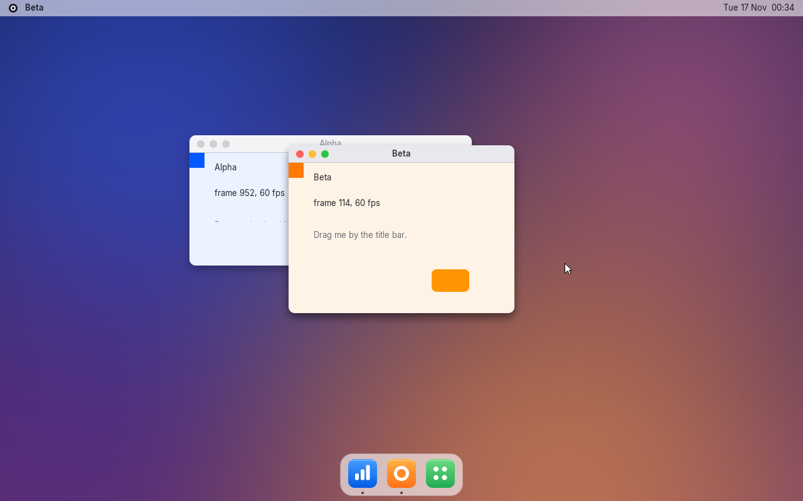

# 09 - The desktop

A wallpaper, a translucent menu bar with a clock, a dock, and windows with
shadows and rounded corners.

Everything here is original: the wallpaper is computed, the icons are drawn
by code, the font is Inter (SIL Open Font License).

## Who draws what

| Part | Process | Window kind |
|---|---|---|
| wallpaper | `/bin/desktop` | desktop (always at the bottom) |
| menu bar | `/bin/desktop` | panel (always on top) |
| dock | `/bin/desktop` | panel |
| title bars, shadows, corners | `/bin/compositor` | - |
| window contents | each application | normal |

`/bin/desktop` is an ordinary client with one privilege: it registers as the
**shell**. The server then sends it a `SHELL_WINDOW` message whenever an
application window appears, changes title, gains or loses focus, is
minimized or goes away, and accepts `SHELL_ACTIVATE` from it.

## Window server additions

### Shadows

A window's shadow is a blurred dark copy of its outline. Blurring something
window-sized every frame is far too slow, but the blurred outline of a
rounded rectangle is the same along each straight edge and its corners do
not depend on the window's size. So one 97x97 texture is blurred once at
start-up and stretched: corners are copied, edges repeat one row or column
(*nine-slice*). The part of the shadow hidden under the window, most of it,
is skipped.

A focused window gets a stronger shadow, which reads as "nearer".

### Rounded corners

Top corners belong to the title bar, which is drawn as a rounded rectangle.
Bottom corners belong to the client's square buffer: the content is copied
row by row, and in the two bottom corner squares each pixel is blended with
a precomputed coverage value instead.

### Frosted glass

Menu bar and dock are created with `BLUR_BEHIND`. When composing such a
window the server copies what is already composed behind it, blurs the
copy (two box-blur passes, radius 9), and draws the panel over it. The blur
is faded in across the panel's soft edge so there is no hard boundary.

A blurred area depends on everything behind it, so damage that touches a
frosted panel is first grown to cover the panel's whole frosted area.

`gfx_box_blur` (libgui) uses running sums: each pixel costs two reads
whatever the radius, and a 2D blur is a horizontal pass followed by a
vertical one.

### Input regions

The dock's window is taller than the visible shelf, to leave room for icons
to grow. A client can restrict where its window reacts to the pointer
(`SET_INPUT_REGION`); elsewhere clicks go to whatever is below. The same
rectangle limits the frosted area.

### Minimize, zoom, resize

- **Minimize** (yellow button): the window is hidden and loses focus; the
  shell is told. Clicking its dock icon restores it.
- **Zoom** (green button): toggles between the window's size and the *work
  area*, the screen minus the strips panels reserve at the top and bottom.
- **Resize**: drag the right edge, bottom edge or bottom-right corner.

Resizing needs the client: the server sends `RESIZE_REQUEST`, the client
attaches a new buffer, draws and commits. Two rules keep it smooth:

1. The old buffer stays on screen until the first commit on the new one, so
   an empty window is never shown. A position change (zoom) is applied in
   the same frame.
2. Only one request is outstanding. While it is, the wanted size just
   follows the mouse; when the answer arrives the latest wanted size is
   requested. Intermediate sizes are skipped instead of queued.

## The desktop shell (`user/desktop`)

**Wallpaper.** Computed once per start: a dusk gradient with four large
soft glows (smoothstep fall-off, so no edge is visible), plus less than one
step of noise before rounding to 8 bits. That *dithering* hides the bands a
gentle gradient would otherwise show.

**Menu bar.** A mark, the focused application's name in semibold, and the
date and time. It redraws when the name changes or a new minute begins, and
otherwise sleeps.

**Clock.** The kernel reads the PC's battery-backed clock once at boot
(`arch/x86_64/rtc.c`) and from then on adds the uptime; `SYS_WALL_TIME`
returns seconds since 1970 UTC. The menu bar adds the offset from
`/etc/saddev.conf` (`timezone_minutes=300`, UTC+5) and converts to a
calendar date itself.

**Dock.** A rounded translucent shelf of icons. A dot marks applications
with an open window. Clicking an icon activates the application's window
(preferring a minimized one) or starts the program.

**Icons.** Drawn by code as 96-pixel tiles and scaled down with
`gfx_blend_scaled` (bilinear sampling), so one drawing serves every size.

For this phase the dock holds three demo programs; real applications
replace them in Phase 11.

## Check

`user-desktop` starts the server and the shell;
`tools/qemu-desktop-check.py` then verifies, from screenshots and logs:

1. wallpaper present and not flat; menu bar much brighter than the sky
   below it yet not opaque; dock shelf visible; first icon is the blue one;
2. clicking a dock icon starts the application, the menu bar shows its
   name, a dot appears under the icon;
3. the area just below the window is darker than the bare wallpaper
   (shadow) but 60 pixels below it is not; the bottom corner pixel is not
   window-coloured (rounded);
4. dragged behind the dock, the window shows through the shelf, tinted and
   not in front of the icons;
5. minimize hides the window and keeps the dot; the dock restores it to the
   same place;
6. zoom fills exactly the work area; zooming again restores size and place;
7. dragging the corner resizes to exactly the dragged size, redrawn;
8. the frame rate reported throughout stays at 55 or above (measured: 59.9
   to 60.1).

## Known limits

- Minimize, restore and zoom happen instantly; animating them is Phase 10.
- Menus are not implemented: the bar shows the application name only.
- Resizing works from the right and bottom edges, not the left or top.
- The blur treats the panel's rectangle as its edge, so colours from just
  outside the panel do not bleed in.
