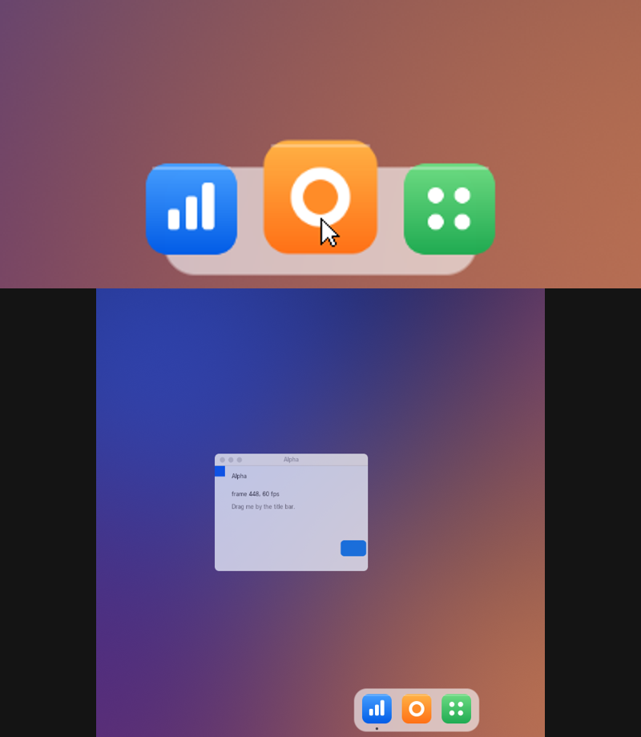

# 10 - Animations

*Top: the dock with the pointer over the middle icon. Bottom: a window
half-way through being restored from the dock, scaled and translucent.*

## The engine (`user/libgui`, `<gui/anim.h>`)

### Time, not frames

Every function takes the current time and computes where the animation
should be at that instant. Nothing counts frames. An animation therefore
takes the same wall-clock time and passes through the same positions whether
the display manages 60 frames per second or 20; a slow frame makes it
coarser, never slower.

### Easing

An easing function maps linear time `t` in [0, 1] to progress in [0, 1].

| Function | Shape | Used for |
|---|---|---|
| `anim_ease_in_out_cubic` | slow, fast, slow | things that travel (minimize, restore) |
| `anim_ease_out_cubic` | fast start, gentle stop | things appearing after an action (open) |
| `anim_ease_in_cubic` | gentle start, fast end | things leaving (close) |
| `anim_linear` | constant | - |

### Tween

`anim_tween` moves one value from A to B in a fixed time through an easing
function. `anim_tween_value(tween, now)` is a pure function of `now`: asking
twice, or out of order, gives the same answer.

### Spring

`anim_spring` pulls a value towards a target like a damped spring
(`acceleration = stiffness * distance - damping * velocity`). It has no
fixed duration and its target can change at any moment; it simply continues
from its current position and speed, so interrupted motion stays smooth.

The simulation advances in **fixed 2 ms steps** however much time passed
between two calls. Stepping by the frame time would make the result depend
on the frame rate, and one long frame could make the integration unstable.
Velocity is updated before position (semi-implicit Euler), which stays
stable where the naive order does not.

## Window animations (`user/compositor/anim.c`)

An animated window is not drawn from its live buffer. When an animation
starts the server paints the window once, title bar and content, into an
image, and for the duration draws that image scaled, moved and faded with
`gfx_blend_scaled`. The image can outlive its window, which is what lets a
closed window fade away after its application has already exited.

| Animation | From / to | Time | Easing |
|---|---|---|---|
| open | 90% size, transparent -> full size, opaque | 220 ms | ease-out |
| close | full size, opaque -> 88% size, transparent | 180 ms | ease-in |
| minimize | the window's frame -> its dock icon, fading to 35% | 340 ms | ease-in-out |
| restore | the reverse | 340 ms | ease-in-out |

- While an *open* or *restore* animation plays, the real window exists and
  can have the focus, but is neither drawn nor hit by the pointer; it is
  revealed in the frame the animation ends.
- The minimize target is the window's dock icon. The shell reports each
  window's icon rectangle (`SHELL_ICON_RECT`).
- Each frame, the previous and the new rectangle of every animation are
  added to the damage list, and the frame loop keeps running while any
  animation is active.
- If there is no free slot or no memory, the change simply happens at once.

## Dock animations (`user/desktop/dock.c`)

**Magnification.** Each icon has a scale spring. Its target is
`1 + 0.55 * cos^2` of the pointer's distance from the icon, reaching zero
110 pixels away: 155% under the pointer, less for the neighbours. Icons keep
their gaps, so a growing icon pushes the others aside; all stand on one
ground line and grow upwards. The springs are slightly under-damped, which
gives a hint of overshoot.

While the pointer is over the dock, the dock's input region is extended
upwards. Without that the pointer would "leave" as soon as it moved onto the
grown part of an icon, and the icon would shrink away from it.

**Launch bounce.** The icon of a starting application hops (half a sine wave
of 20 pixels every 420 ms, as a function of time) until its window appears,
then finishes the current hop so it ends on the ground. It gives up after
six seconds.

**Pacing.** The dock commits a frame asking for a frame event and draws the
next step when the event arrives, so it animates at the display's rate and
stops entirely when nothing moves.

## Dragging and resizing

A dragged window follows the pointer in the same frame the mouse event is
processed: the server moves it itself, without asking the application.
Resizing does need the application; the two rules that keep it smooth are in
[09-desktop.md](09-desktop.md).

## Checks

`user-anim` tests the engine with made-up clock values, so results are
exact: easing endpoints, monotonicity and symmetry; tween values at given
times and after the end; a critically damped spring that never overshoots
and an under-damped one that does; and **the same spring sampled at 100 and
at 20 frames per second being in the same place at the same time**.

`user-animations` runs the desktop with window animations slowed six times
(`--animation-scale=6`), which is trivial precisely because they are
time-based, and photographs each one half-way:

| Animation | Half-way picture must show | Measured (target) |
|---|---|---|
| dock magnification | the hovered icon covering a spot above its resting top; 155%; back to rest when the pointer leaves | - |
| launch bounce | ends on the ground, at a multiple of the hop time | - |
| open | a pixel that is neither window nor wallpaper (a blend), changed area smaller than the frame | 1335 ms (1320) |
| minimize | a small image between the window's place and its dock icon | 2044 ms (2040) |
| restore | the same, growing | 2053 ms (2040) |
| close | a blend again; nothing left afterwards | 1088 ms (1080) |

Durations are measured by the server's clock and must be within 10% of the
target. The frame rate during all of it stayed between 59.4 and 60.2.

## Known limits

- Zoom changes size in one step.
- An animated window shows a still image of itself; content that changes
  during those 200-340 ms is not updated.
- Scaling a very large window (a zoomed one being minimized) costs several
  milliseconds per frame without hardware acceleration.
