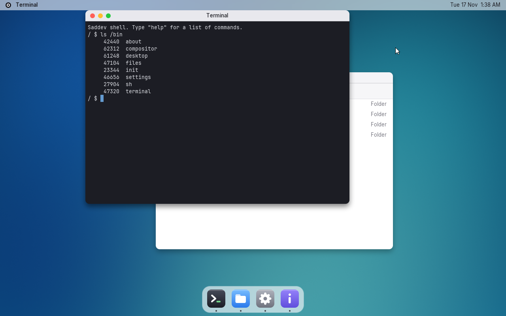
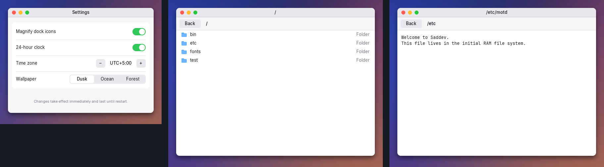

# 11 - Applications





Five programs under `user/apps`, each a directory that the build turns into
`/bin/<name>`. The dock shows four of them; the fifth, the shell, runs
inside the terminal.

## Shared look: `<gui/ui.h>`

`libgui` gained a small set of drawing helpers so the applications look
alike: named fonts loaded on first use, a colour palette, text aligned in a
rectangle, and four controls (button, on/off switch, segmented choice,
stepper built from two buttons).

They are helpers, not objects. An application keeps its own state, asks the
helpers to draw it, and tests clicks against the same rectangles it drew.
With four small programs that is less code than a widget tree would be.

## Terminal and shell

The terminal is a window; the shell is a separate program. They are
connected by a channel:

```
keys -> terminal (line editing, screen) ==channel==> /bin/sh (stdin)
        terminal draws the text       <==channel==  /bin/sh (stdout)
```

**Starting a program with other standard files.** `spawn` gained a third
argument: three descriptors of the caller that become descriptors 0-2 of
the new program. The terminal creates a channel pair, gives one end to the
shell as its input, output and error, and keeps the other.

**Line editing happens in the terminal.** Typed characters are collected
and echoed there; a whole line is sent when Enter is pressed. That keeps
the shell simple, and it is what makes channels usable as standard input:
a channel delivers whole messages, so one message is one line.

Two libc changes follow from this:

- input is buffered (`getchar` cannot ask a channel for "one byte");
- `write` waits and retries when a channel's queue is full, because
  programs expect output to block rather than fail.

**The terminal** keeps 600 lines of scrollback in a ring, decodes UTF-8,
handles newline, carriage return, backspace, tab and form feed (clear),
places every character on a fixed grid (JetBrains Mono, rasterized at build
time like Inter), and offers command history (up/down), Ctrl+L and Ctrl+D.
It redraws at most once per frame: output arriving while a frame is on its
way to the screen just marks the screen dirty.

**The shell** (`/bin/sh`) has built-ins `help ls cd pwd cat echo clear date
uptime mem log exit` and runs anything else from `/bin`. It keeps a current
directory of its own (the kernel has none) and resolves relative paths,
including `.` and `..`, before using them.

## Files

Lists a directory (folders first, then by name, with sizes), enters folders
and shows text files in a monospace view; Back leaves the file, then the
folder. The mouse wheel scrolls.

## Settings

The settings belong to the desktop shell, not to the Settings program,
which is a remote control for them. The shell listens on the named port
`saddev.settings`; a client that connects is sent the current
`struct shell_settings` and may send back a changed copy at any time. The
shell brings every field into range, applies it and redraws.

| Setting | Effect |
|---|---|
| Magnify dock icons | springs' targets stay at 1.0 |
| 24-hour clock | menu bar shows `17:05` or `5:05 PM` |
| Time zone | half-hour steps from UTC-12 to UTC+14 |
| Wallpaper | Dusk, Ocean or Forest; recomputed at once |

They last until restart: the only file system is read-only.

## About

Name, version, and figures refreshed every second from the new
`SYS_SYSINFO` call: memory, display size, uptime, process and thread
counts.

## Check

`user-apps` runs the real desktop; `tools/qemu-apps-check.py` uses each
application as a person would.

| Step | Verified by |
|---|---|
| Terminal starts from the dock, shows a prompt | log line, screenshot |
| typing `log hello-from-the-terminal` runs it | the shell's line in the system log |
| `cat /etc/motd`, `ls /`, `mem` print output | the text area fills |
| `exit` closes the terminal | the window's close animation |
| Files: open `etc`, then `motd`, Back twice | log lines; the first listing is restored pixel for pixel |
| Settings: magnification off | hovering the dock no longer grows icons |
| 24-hour clock off | the menu bar's clock changes |
| time zone + | the shell reports UTC+330 minutes |
| wallpaper Ocean | the screen turns from red-violet to blue-green |
| About starts | log line, menu bar shows its name |

### A bug this check found

Switching a setting crashed the desktop shell: the kernel reported a page
fault at address `0x12c` and ended the process, and kept running. The
address is 300, the time zone in minutes. The shell's log line used
`"%+d ... %s"`, and this libc's `printf` did not know the `+` flag: it
printed `%+` literally and consumed no argument, so `%s` then took the
integer 300 as a string pointer.

The compiler could not warn, because it checks format strings against
standard `printf`, which does support `+`. Both `printf` implementations
(libc and kernel) now support the flag, with tests that a flag does not
disturb the arguments after it.

## Known limits

- No text selection or copy and paste; no pipes or redirection in the shell.
- A program running in the terminal cannot be interrupted (no signals).
- Files shows text only, up to 256 KiB.
- Settings are not saved across restarts.
