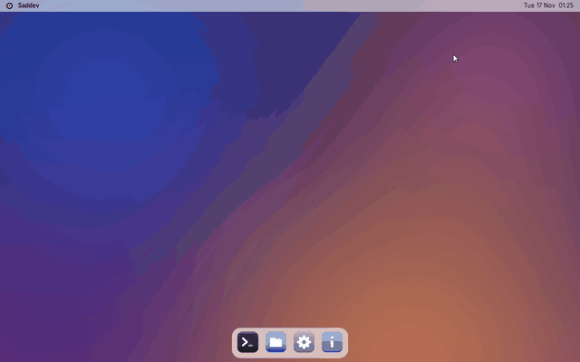

# 12 - Polish: measuring, speeding up, leak checks, demo



## Measure first: `make bench`

`user/tests/gfxbench.c` times every drawing operation the window server
depends on and prints nanoseconds per pixel. The numbers below are from
QEMU's software emulation (TCG) on the development machine, so they say
which operation is expensive relative to the others, not how fast real
hardware is.

| operation | before | after |
|---|---|---|
| clear | 0.45 ns/px | 0.45 ns/px |
| copy (blit) | 2.1 ns/px | 2.1 ns/px |
| fill, 50% alpha | 6.4 ns/px | 6.4 ns/px |
| blend a picture | 8.8 ns/px | 8.8 ns/px |
| blend, scaled (bilinear) | 28.8 ns/px | 28.8 ns/px |
| box blur, radius 12, 2 passes | 216-241 ns/px | (no longer used per frame) |
| backdrop blur for panels | - | 41 ns/px |
| text | ~590 ns/glyph | ~590 ns/glyph |

One line stood out: the blur behind the menu bar and the dock cost about
thirty times as much per pixel as anything else, and it ran every time
something moved underneath a panel.

## What was changed

**A cheaper blur.** `gfx_blur_backdrop()` shrinks the area to a quarter of
its width and height, blurs that small picture with a small radius, and
stretches it back with bilinear filtering. A blur removes fine detail
anyway, so doing it at a sixteenth of the pixel count looks the same and
costs a fifth.

**Blur only when the scene changes.** Each panel keeps its blurred backdrop.
Damage is now of two kinds: *scene* damage (the wallpaper or an application
window changed) invalidates the backdrops it touches, *overlay* damage (the
pointer, an animation image, the panel's own content such as the clock or a
growing dock icon) does not. Moving the pointer across the dock used to
re-blur the dock on every frame; now it reuses the stored picture.

**Do not draw what cannot be seen.** Before drawing a damaged rectangle the
server looks for the topmost window that covers it completely and is fully
opaque, and starts drawing there. Under a maximized window nothing below is
drawn at all.

**Row operations with SSE2, chosen by measurement.** The three inner loops
that everything else is built from (fill a row, blend a row, blend a row
with an extra opacity) have a portable C version and an SSE2 version
(`user/libgui/arch/x86_64/rowops_sse2.c`, four pixels at a time). At start
`libgui` times both on a small buffer and uses the faster one.
`gfx_rowops_verify()` runs both over the same random data; the test suite
requires that they differ in zero pixels.

Under TCG the portable loops win (emulating each SSE2 instruction costs
more than it saves), so that is what the numbers above use. On a real CPU
or under KVM the selection goes the other way. This could not be measured
here: the build machine has no `/dev/kvm`.

### Effect on whole frames

Same scripted sessions (`check-user-desktop`, `check-user-compositor`),
before and after, work per frame as measured by the server itself:

| scenario | mean before | mean after | worst before | worst after |
|---|---|---|---|---|
| desktop: dock, menu bar, pointer, windows | 2353 us | 1579 us | 15.5 ms | 15.0 ms |
| two plain windows, no panels | 2019 us | 2006 us | 10.2 ms | 5.6 ms |

A frame at 60 Hz has 16.7 ms. The desktop scenario's average dropped by a
third. The worst frame is the first one, which draws the entire screen; it
still fits.

## Leak checks

Three layers, each with a different view of "nothing was lost".

**Library level - `check-user-leak`.** `libc` counts the bytes handed out by
`malloc` and not yet freed (`malloc_bytes_in_use()`). `user/tests/leak.c`
repeats a piece of work 25 times - load a font, create surfaces, draw,
blur, destroy - and requires the count to be exactly back at its starting
value after every round.

**Server level - inside `check-user-session-leak`.** The window server runs
for the whole session, so what it loses per window adds up. Started with
`--run-for=MS` it samples its own memory use whenever it is idle and
remembers the value per situation (number of clients and windows). When it
exits it requires that no situation it saw repeatedly needed more memory
later than earlier (`user/compositor/leakwatch.c`). The test opens and
closes 75 windows meanwhile.

**Kernel level - `check-user-session-leak`.** The whole graphical session
(server, desktop, an animated client, the window-churning client) is run
twice. After the second run every physical frame, heap block, thread and
process the kernel handed out must be back.

Each was validated with a negative control: a deliberate 48-byte leak per
destroyed window in the server makes the session check fail with

```
compositor: LEAK: with 2 clients and 4 windows memory grew from 4359152 to 4362352 bytes
```

(75 windows x 48 bytes, rounded up by the allocator to 3200.) Nothing in the
tree needed fixing: the checks found no leak.

## The demo: `make demo`

Boots the desktop without a display and drives it over QEMU's machine
protocol: sweeps the pointer over the dock, starts the terminal and types
commands, browses in Files, drags a window, minimizes and restores, changes
the wallpaper in Settings, opens About. A recorder thread photographs the
screen five times per second. The result is in `build/demo/`: six
screenshots and `saddev-demo.gif`.

It is the same mechanism the graphical checks use (`tools/qmplib.py`), so
the demo cannot show something the system does not actually do.

## Known limits

Stated plainly, so nobody has to discover them:

- **One CPU.** The kernel does not start the other cores. Its locks are
  written for SMP (spinlocks that disable interrupts) but that has never
  been exercised.
- **No disk, no network, no sound.** The file system is the read-only
  archive loaded at boot plus device files. Nothing is saved across boots.
- **No USB.** Keyboard and mouse are PS/2, which QEMU and older machines
  provide; a modern laptop without PS/2 emulation would have no input.
- **Software rendering only**, on the frame buffer the boot loader set up.
  No resolution change after boot.
- **No user accounts or permissions.** Every process may open every file
  and connect to every port. A process cannot touch another's memory, but
  that is the only wall.
- **60 FPS is demonstrated under emulation at 1280x800** for the scripted
  sessions, with the work per frame logged. It was not measured on real
  hardware or under KVM.
- **Not tested here:** `make run` with a visible window (the build machine
  has no display; everything was verified headless through screenshots),
  `TOOLCHAIN=gcc`, and the NMI path.
